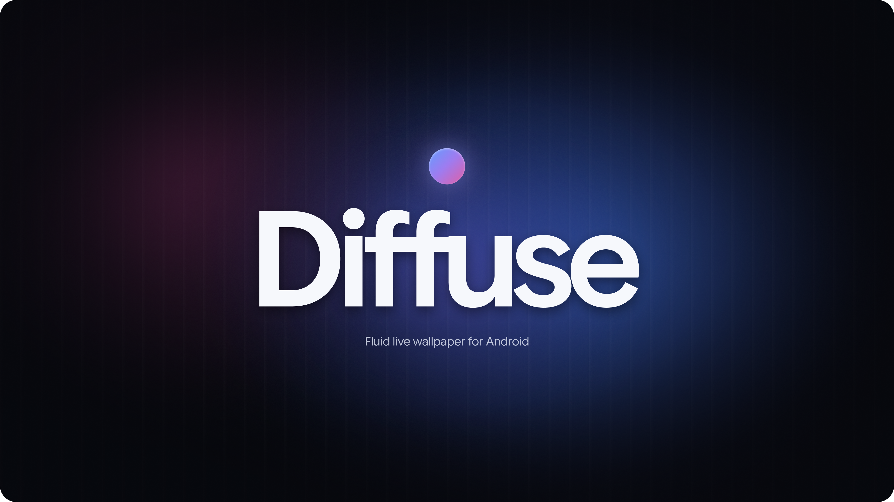

<p align="center">
  
</p>

<h1 align="center">Diffuse Live Wallpaper</h1>

<p align="center">
  <a href="https://github.com/isaiahscape/diffuse/actions/workflows/build.yml">
    
  </a>
  <a href="https://github.com/isaiahscape/diffuse/actions/workflows/release.yml">
    
  </a>
  <a href="https://github.com/isaiahscape/diffuse/releases">
    
  </a>
  <a href="LICENSE">
    
  </a>
  <a href="https://ko-fi.com/isaiahscape">
    
  </a>
</p>

<p align="center">
  Editable Kotlin Android Gradle project reconstructed from the Play Store release <code>com.depthware.lwp.diffuse.v2</code> (1.1.0.0 (3433)-PUB, versionCode = 3433). Also ported to Windows 11 at <a href="https://github.com/isaiahscape/windiffuse"><strong>Diffuse for Windows</strong></a>.
</p>

---

## Key Differences from Raw Play Store APK

1. **Kotlin + ViewBinding**: All app-owned classes are cleanly reconstructed in idiomatic Kotlin with ViewBinding instead of generated DataBinding adapters.
2. **Telemetry & Licensing Stubs Removed**: Sentry crash reporting and Google Play License Verification (`LVLLibrary`) were stripped so local debug/feature builds run offline without Play licensing failures or telemetry uploads.
3. **Renderer & Visualizer Fixes (from `report.md`)**:
   - `DiffusePlayer.setAlbumToBlur()` binds `fboB.colorBufferTexture.bind(1)` (color-buffer texture rather than raw FBO ID) to texture unit `1`.
   - `AudioVisualizerManager.frequencyToBin()` converts `samplingRate` from milliHertz (`samplingRate / 1000.0f`) before computing FFT bin indices.
   - `NotificationPeekService.REQUIRE_NON_CLEARABLE` is exposed as a boolean flag (`false` by default) so modern dismissible media notifications with `Notification.EXTRA_MEDIA_SESSION` are recognized automatically.


## Building & CI Workflow

Set `ANDROID_HOME` (or `sdk.dir` in `local.properties`) to an Android SDK installation with **Android SDK Platform 35** (`compileSdk = 35`) and **JDK 21**, then open `diffuse-kotlin/` in Android Studio or run:

```powershell
.\scripts\build.ps1 assembleDebug
.\scripts\build.ps1 assembleRelease
```

### Release Signing

Release builds look for signing credentials in this order:
1. `KEYSTORE_FILE`, `KEYSTORE_PASSWORD`, `KEY_ALIAS`, `KEY_PASSWORD` environment variables (used in CI)
2. Local `keystore.properties` (ignored by git; see `keystore.properties.example`)
3. Fallback to the default debug keystore if neither is present

### GitHub Actions Workflows

- `.github/workflows/build.yml` — Runs on `push`, `pull_request`, and manual `workflow_dispatch`: executes `testDebugUnitTest`, `lintDebug`, `assembleDebug`, and `assembleRelease`, and uploads APKs and reports as artifacts.
- `.github/workflows/release.yml` — Runs on `v*` tags or manual `workflow_dispatch`: signs and publishes a GitHub Release APK.

To enable release signing in GitHub Actions, set these repository secrets (`KEYSTORE_BASE64`, `KEYSTORE_PASSWORD`, `KEY_ALIAS`, `KEY_PASSWORD`), where `KEYSTORE_BASE64` is produced on Windows via:

```powershell
[Convert]::ToBase64String([IO.File]::ReadAllBytes("app/diffuse-release.jks"))
```

## Credits

- **[JustZht](https://github.com/JustinFincher)** (**Depthware** / **[FinGameWorks](https://github.com/FinGameWorks)**) — Creator of the original **Diffuse** Android live wallpaper, fluid shader design, and color palettes.
